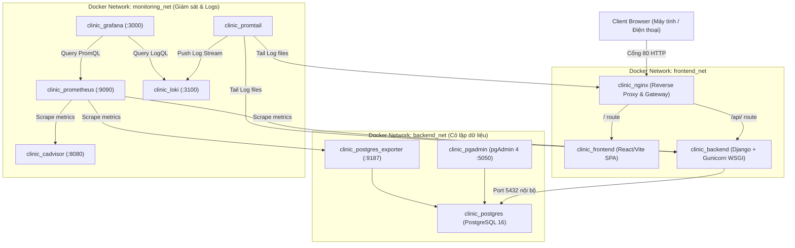

# TÀI LIỆU KIẾN TRÚC HỆ THỐNG (SYSTEM ARCHITECTURE)

- **Hệ thống**: Clinic Management System (Phòng khám Đa khoa Phúc An)
- **Sinh viên thực hiện**: Nguyễn Văn Thắng (MSV: DTC245200146)

---

## 1. MÔ HÌNH KIẾN TRÚC TỔNG THỂ (CONTAINER ORCHESTRATION)

---

## 2. PHÂN TÁCH VÙNG MẠNG BẢO MẬT (NETWORK ISOLATION)
Hệ thống thiết lập 3 mạng ảo biệt lập theo nguyên tắc **Defense in Depth**:
1. `frontend_net`: Cho phép `nginx`, `frontend` và `backend` giao tiếp phục vụ người dùng.
2. `backend_net`: Cô lập hoàn toàn cơ sở dữ liệu `postgres`, `pgadmin` và `postgres-exporter`. Người dùng từ mạng ngoài không thể kết nối trực tiếp đến cổng 5432 của PostgreSQL.
3. `monitoring_net`: Mạng riêng để `prometheus`, `grafana`, `loki` và `promtail` thu thập dữ liệu giám sát và logs mà không làm ảnh hưởng đến lưu lượng nghiệp vụ chính.
