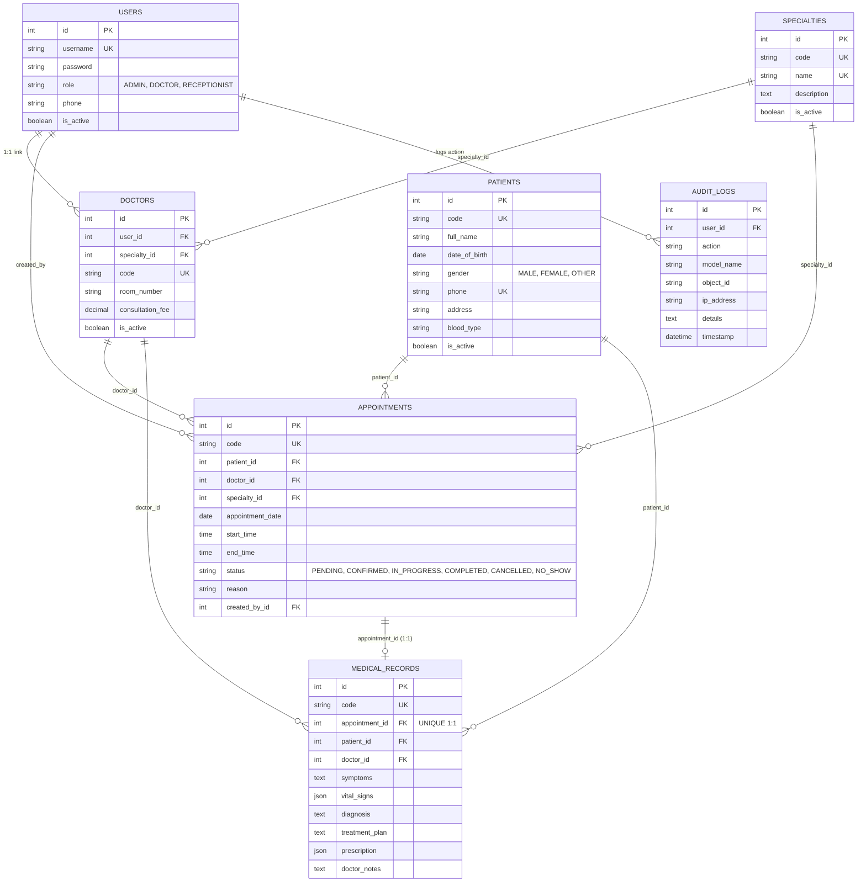

# THIẾT KẾ CƠ SỞ DỮ LIỆU POSTGRESQL (DATABASE DESIGN & ERD)

- **Hệ quản trị CSDL**: PostgreSQL 16
- **Database**: `clinic_db`
- **Timezone**: `Asia/Ho_Chi_Minh`

---

## 1. SƠ ĐỒ THỰC THỂ QUAN HỆ (ERD)



---

## 2. RÀNG BUỘC CHỐNG TRÙNG LỊCH (ANTI-OVERLAP INTERVAL CHECK)
Thuật toán chống trùng lịch tại tầng nghiệp vụ và cơ sở dữ liệu:
```sql
SELECT id FROM appointments
WHERE doctor_id = :new_doctor_id
  AND appointment_date = :new_date
  AND status IN ('PENDING', 'CONFIRMED', 'IN_PROGRESS')
  AND start_time < :new_end_time
  AND end_time > :new_start_time;
```
Nếu có bất kỳ bản ghi nào trùng khớp, hệ thống từ chối tạo lịch và ném ngoại lệ Validation Error.
